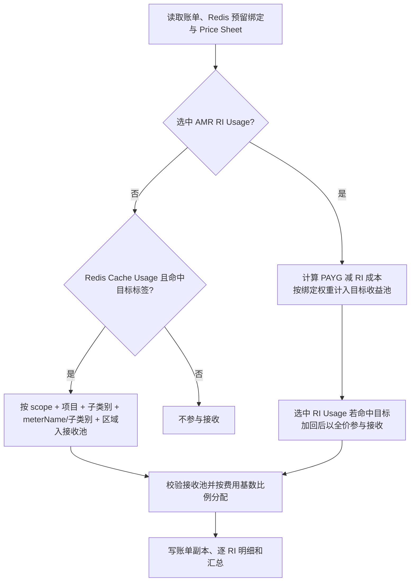

# RI(AMR) 经济责任重新分摊说明

## 1. 目的

将 Azure Managed Redis（AMR）RI 实际使用产生的收益或超额成本，按
`reservations.json` 中的项目绑定权重重新分摊。
`reallocate_amr_ri.py` 复用 `ri_reallocation_core.py` 的分摊核心，
但只处理 `Redis Cache` 类别。脚本输出新的账单副本，不修改原始
`tags`、`ResourceId`、`pricingModel` 或 `costInBillingCurrency`；
推荐先通过 `allocate_ri_difference.py` 对齐 Actual 与 Amortized。

## 2. RI 使用记录识别规则

```text
meterCategory = Redis Cache
pricingModel = Reservation
chargeType = Usage
reservationId = 本次 productType=redis 且有有效 bindings 的预留 ID
```

**选中 RI Usage 不按 `meterSubCategory` 预先筛选。** 配置可直接指定
账单 `reservationId`，或通过 `externalReservationId` 的
`/reservations/<reservation-id>` 段提取；若指定
`"order:<订单 GUID>"`，会通过 RI Usage 的
`additionalInfo.ReservationOrderId` 关联账单中的 `reservationId`。
订单无匹配或没有已绑定 RI Usage 会报错。

`--amount-field` 默认 `costInBillingCurrency`，也可在 Actual 差额调整后
设为 `costInBillingCurrencyAfterActualReconciliation`。PAYG 等价成本
取本地 Azure Price Sheet 中匹配 `meterId`、使用日期及账单币种的
Consumption `unitPrice × quantity`，再减 RI Usage 成本基准：
正数是收益，负数是超额成本。缺价或多价格歧义会报错，不以同批按需
账单行或公开零售价代替。`UnusedReservation` 只汇总、不参与分摊。

## 3. 分摊逻辑

### 3.1 处理流程



### 3.2 RI 使用记录与目标项目

`productType=redis` 的预留中，`bindings[].project` 映射为
`<--project-tag-key>=<project>` 的账单标签。同一预留、同一项目的有效
`boundQuantity` 会合并；非正权重被忽略，没有有效 binding 的预留
被跳过，全部都无有效 binding 时会报错：

```text
RI 使用净收益/损失 = Price Sheet PAYG 等价成本 − RI Usage 成本基准
目标贡献 = RI 使用净收益/损失 × boundQuantity / boundTotal
RI Usage 加回金额 = 各目标贡献之和
RI Usage 净调整额 = 加回金额 − 该行作为目标接收方的应摊份额
```

`boundTotal` 缺失、非正或小于绑定权重之和时，使用绑定权重之和；
否则未绑定份额仍由实际使用该 RI 的原项目承担，不搬到目标。

接收行必须是 `meterCategory=Redis Cache`、`chargeType=Usage`，
命中项目标签且位于该 RI 的 `appliedScopeType` / `appliedScopeId`
优惠范围内；其他类别及非 Usage 行不参与接收。
分摊池按 **RI scope + 项目 + `meterSubCategory` + 匹配键 + 区域**
隔离。`flexibility=on` 时匹配键**仅为同一 `meterSubCategory`**，
可将相同子类别、不同 `meterName` 的规格分到同一池；
其他值时要求**同一子类别、同一 `meterName`**。
区域依次取 `meterRegion`、`resourceLocation`、`location`。
例如 Balanced 和 Memory Optimized 子类别不会互相接收，即使都属于
`Redis Cache`。同一项目被不同匹配模式的 RI 绑定会报错。

所有满足条件的 Redis Cache Usage 都可成为接收行，包括其他 RI Usage。
若所选 RI Usage 自身也命中目标，先加回本 RI 搬走的金额，再以
**成本基准 + 加回金额**进入接收池；其他行使用成本基准。
同一池的有符号收益按费用基数比例分摊：正收益减少目标费用，
超额成本增加目标费用。非零收益池没有接收费用时会报错；
正收益超过接收池费用时也会报错以防负费用。

### 3.3 金额守恒

选中 RI Usage 加回合计 = 目标行承接合计；所有输入行分摊前后
总金额相等。金额以 `Decimal` 运算。

## 4. 输出字段

在账单原始列之后追加：

| 字段 | 说明 |
|---|---|
| `allocatedCostInBillingCurrency` | 成本基准 + `riAllocationAmount`，不改原始账单金额 |
| `riAllocationAmount` | 有符号调整；源 RI 正收益为正、目标行负，超额成本相反 |
| `riPaygEquivalentAmount` | 选中 RI Usage 的 PAYG 等价成本；其他行为空 |
| `riAmortizedCost` | 选中 RI Usage 的成本基准；其他行为空 |
| `riBenefitOrLoss` | 选中 RI Usage 的有符号收益/损失；其他行为空 |
| `allocationType` | `RI_USAGE_COST_REASSIGNED` 或 `RI_BENEFIT_ASSIGNED`，无调整时为空 |
| `allocationTarget` | 分摊目标项目，未调整时为空 |

RI Usage 既作为源又作为目标时，此行 `riAllocationAmount` 是两种
贡献抵消后的净额；分项见 `ri-allocation-details.csv`。

## 5. 脚本文件

使用 `reallocate_amr_ri.py`（`AMR` profile），实际分摊逻辑位于
`ri_reallocation_core.py`；不应使用 VM 入口代跑 Redis 分摊。

## 6. 执行方法

在 `ri-reallocation/` 目录准备 Amortized CSV、覆盖同一账期的本地
Azure Price Sheet（CSV、ZIP 或 JSON）及 `reservations.json`：

```json
[
  {
    "productType": "redis",
    "externalReservationId": "order:<reservation-order-id>",
    "appliedScopeType": "Shared",
    "flexibility": "on",
    "boundTotal": 3,
    "bindings": [
      {"project": "<project-a>", "boundQuantity": 2},
      {"project": "<project-b>", "boundQuantity": 1}
    ]
  }
]
```

配置顶层也可为单个预留对象或 `{"reservations": [...]}`。
`Shared`（或缺省）在输入范围内匹配；`Single` 只匹配指定订阅或
资源组，`ManagementGroup` 需 Azure 登录及相应管理组/租户读取权限。
多份输入 CSV 的表头必须一致。必填参数为 `--reservations-file`、
`--project-tag-key`、`--price-sheet-file`：

```bash
python3 -m pip install -r requirements.txt
python3 reallocate_amr_ri.py "input/amortized/Amortized_*.csv" \
  --reservations-file reservations.json --project-tag-key projname \
  --price-sheet-file azure-price-sheet.json --output-dir work/02-amr
```

推荐先对齐 Actual 与 Amortized，再以调整后的成本为基准：

```bash
python3 allocate_ri_difference.py \
  --actual "input/actual/Actual_*.csv" \
  --amortized "input/amortized/Amortized_*.csv" \
  --output-dir work/01-actual-reconciled
python3 reallocate_amr_ri.py "work/01-actual-reconciled/Amortized_*.csv" \
  --reservations-file reservations.json --project-tag-key projname \
  --amount-field costInBillingCurrencyAfterActualReconciliation \
  --price-sheet-file azure-price-sheet.json --output-dir work/02-amr
```

独立运行 VM、MySQL、AMR 时应使用各自的输出目录，不要把其他类别
已分摊的账单副本用作输入。合并运行使用 `reallocate_all_ri.py`，
见 [RI 经济责任分摊流水线运行指南](RI经济责任分摊流水线运行指南.md)。

## 7. 输出文件

默认输出目录为 `ri-reallocated`；示例写入：

```text
work/02-amr/
├── Amortized_*.csv
├── ri-allocation-details.csv
├── project-allocation.csv
└── ri-summary.json
```

- 账单副本：保留原始字段，追加第 4 节的计算列；未参与的行调整为零。
- `ri-allocation-details.csv`：每条 RI 对源行的贡献有
  `sourceFile`、`sourceRowNumber`、`ResourceId`、`allocationType`、
  `allocationTarget`、`riAllocationReservationIds`、`allocationAmount`；
  按源文件和行号合计为该行的 `riAllocationAmount`。
- `project-allocation.csv`：每个项目的 `beforeAmount`、
  `afterAllocatedAmount`、`delta`、`riAmountAdded`、
  `riAmountAssigned`。首列固定叫 `projname`，不随项目标签键改变。
- `ri-summary.json`：包含 `reservationIds`、`matchModeByReservation`、
  `riNetBenefitOrLoss`、`riAllocatableAmount`、`riUnusedCost`、
  `riPortfolioNetSavings`、`assignedByTarget` 与各池 `riAllocationKeys`。
  兼容键 `targetVmReceiverAmount` 在此实际表示 **AMR 接收池金额**，
  并非 VM 接收池金额。

使用 `--summary-only` 时只生成 `project-allocation.csv` 和
`ri-summary.json`，不会写账单副本或逐 RI 分摊明细。

## 8. 注意事项

输出目录不能与输入账单目录相同。脚本不会修改源 CSV、资源标签、
`ResourceId` 或 Azure 原始成本；`allocatedCostInBillingCurrency`
是选定基准下的分析金额。不存在有效绑定、实际 Usage 或匹配接收行时
会明确报错，未使用预留量不会转移到目标项目。

## 9. 对账与报表

`reconcile_vm_ri_allocation.py` 仅用于 VM，不应拿来对账 AMR。
可使用 `report_ri_project_distribution.py` 对本脚本输出目录生成
RI 项目分布报告，指定 `--project-tag-key` 和
`--reservations-file`；报告需要账单副本及
`ri-allocation-details.csv`，不可与 `--summary-only` 同用。
三类资源合并报表的推荐方式见流水线指南。
