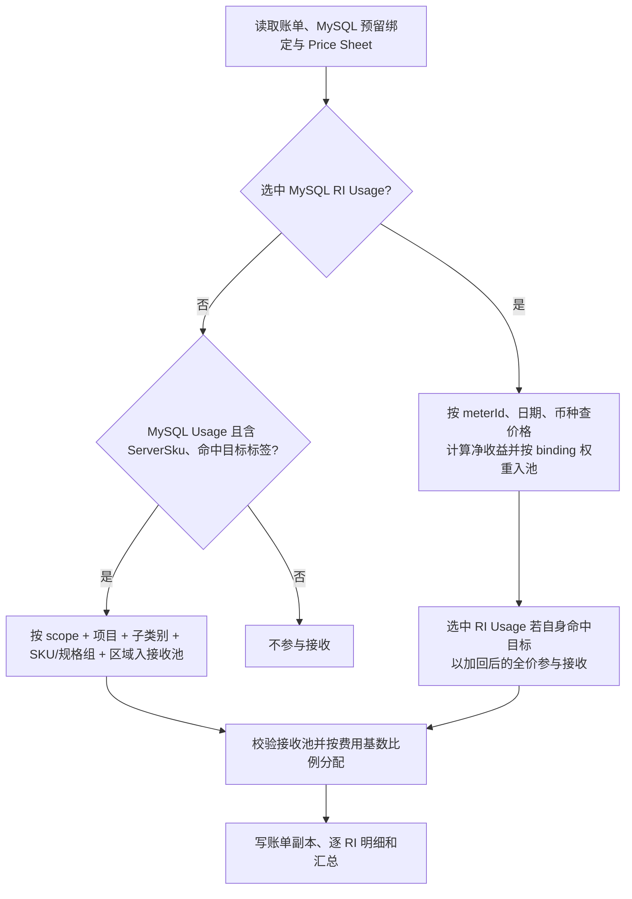

# RI(MySQL) 经济责任重新分摊说明

## 1. 目的

将 Azure Database for MySQL RI 的实际使用净收益或超额成本，按预留定义
`reservations.json` 中的 `bindings[].boundQuantity / boundTotal` 分配给绑定项目。
`reallocate_mysql_ri.py` 调用 `reallocate_vm_ri.py` 的共用分摊逻辑，但只处理
MySQL 类别；输出新的账单副本，不覆盖原始账单的 `tags`、`ResourceId`、
`pricingModel` 或 `costInBillingCurrency`。可先运行 `allocate_ri_difference.py`
将 Actual 与 Amortized 成本对齐，再做经济责任分摊。

## 2. RI 使用记录识别规则

同时满足以下条件的行才是本次选中的 RI Usage：

```text
meterCategory = Azure Database for MySQL
pricingModel = Reservation
chargeType = Usage
reservationId = 本次 productType=mysql 且有有效 bindings 的预留 ID
```

**不按 `meterSubCategory` 筛选 RI Usage。** 如果预留使用
`externalReservationId: "order:<订单 GUID>"`，脚本先从同类别 RI Usage 的
`additionalInfo.ReservationOrderId` 关联账单 `reservationId`；也可直接提供
账单 `reservationId` 或包含 `/reservations/<reservation-id>` 的完整
`externalReservationId`。订单无法关联或选中后没有实际 RI Usage 时会报错。

成本基准由 `--amount-field` 选择，默认 `costInBillingCurrency`；串联 Actual
差额调整时选择 `costInBillingCurrencyAfterActualReconciliation`。每条选中
Usage 的 PAYG 等价成本为 Azure Price Sheet 的 Consumption
`unitPrice × quantity`，有符号经济差额为 **PAYG 等价成本 − RI Usage 成本基准**；
正数为收益，负数为超额成本。必须按 `meterId`、`date`、`billingCurrency`
匹配本地价格表，缺价或出现不同候选价格会报错，不改用公开零售价。
`UnusedReservation` 仅计入汇总，不参与分摊。

## 3. 分摊逻辑

### 3.1 处理流程



### 3.2 RI 使用记录与目标项目

每个 RI 的 `bindings[].project` 对应账单标签
`<--project-tag-key>=<project>`。单条 RI Usage 的加回金额与各目标贡献为：

```text
目标贡献 = (PAYG 等价成本 − RI 成本基准) × boundQuantity / boundTotal
RI Usage 加回金额 = 各绑定目标贡献之和
RI Usage 净调整额 = 加回金额 − 该行作为目标接收行时应承担的份额
```

`boundTotal` 缺失、非正或小于有效 `boundQuantity` 总和时以该总和为分母；
否则未绑定的剩余份额不搬走，留在实际使用 RI 的原项目。同一预留的同名
`project` 权重相加，非正权重被忽略；无有效 binding 的预留跳过，
全部预留均不可用时报错。

候选接收行须同时满足 `meterCategory=Azure Database for MySQL`、
`chargeType=Usage`、`additionalInfo.ServerSku` 非空、目标标签匹配及 RI
`appliedScopeType` / `appliedScopeId` 范围匹配。仅选中 RI Usage 行可不经
普通候选行的 `ServerSku` 过滤，但计算匹配键时仍必须有 `ServerSku`，
缺失会报错；存储等缺少 `ServerSku` 的行不会成为接收方。非 MySQL 行、
非 Usage 行及 `UnusedReservation` 不接收分摊。

每个收益池按 **RI scope + 目标项目 + `meterSubCategory` + SKU（或规格组）
+ 区域** 隔离。SKU 取 `additionalInfo.ServerSku`；`flexibility=on` 时
用与 VM 相同的机型名称启发式规则去掉核数得到规格组，无法解析则保持
原 SKU；其他值按精确 SKU 匹配。区域依次取 `meterRegion`、
`resourceLocation`、`location`。不同子类别即使 SKU 相同也不相互接收。
同一项目被不同匹配模式的预留绑定会报错，须统一其 `flexibility`。

接收池包含所有符合上述规则的 MySQL Usage 行（包括其他 RI Usage）。
本次选中的 RI Usage 若自身标签命中目标，先加回该行应搬走的金额，再以
**成本基准 + 加回金额**作为接收基数；其余行以成本基准为接收基数。
目标行按池内各行费用基数比例扣减正收益或分担负收益。非零收益池无接收
费用时会报错；正收益超过接收池费用时也会报错，避免目标行出现负费用。

### 3.3 金额守恒

所有选中 RI Usage 的加回金额之和等于所有目标行承接的金额之和，
因此分摊前后**全部输入行的金额合计不变**。金额使用 `Decimal` 计算。

## 4. 输出字段

账单副本在原始列后追加：

| 字段 | 说明 |
|---|---|
| `allocatedCostInBillingCurrency` | 成本基准 + `riAllocationAmount`；不修改原始成本列 |
| `riAllocationAmount` | 有符号调整额：源 RI 正收益为正，接收行正收益为负；超额成本相反 |
| `riPaygEquivalentAmount` | 所选 RI Usage 的 Price Sheet PAYG 等价成本；其他行为空 |
| `riAmortizedCost` | 所选 RI Usage 的成本基准；其他行为空 |
| `riBenefitOrLoss` | 所选 RI Usage 的有符号净收益/损失；其他行为空 |
| `allocationType` | `RI_USAGE_COST_REASSIGNED` 或 `RI_BENEFIT_ASSIGNED`，无调整时为空 |
| `allocationTarget` | 对应目标项目标签值；无调整时为空 |

选中 RI Usage 同时作为接收方时，`riAllocationAmount` 是加回和承接
的**净额**；逐 RI 的有符号贡献见 `ri-allocation-details.csv`。

## 5. 脚本文件

`reallocate_mysql_ri.py` 是 MySQL 入口，调用共用的
`reallocate_vm_ri.py`（`MYSQL` profile）；无需改用 VM 命令运行。

## 6. 执行方法

在 `ri-reallocation/` 目录准备同一账期的 Amortized CSV、本地 Azure
Price Sheet（CSV、ZIP 或 JSON）和 `reservations.json`。示例配置：

```json
[
  {
    "productType": "mysql",
    "externalReservationId": "order:<reservation-order-id>",
    "appliedScopeType": "Single",
    "appliedScopeId": "/subscriptions/<subscription-id>",
    "flexibility": "on",
    "boundTotal": 3,
    "bindings": [
      {"project": "<project-a>", "boundQuantity": 2},
      {"project": "<project-b>", "boundQuantity": 1}
    ]
  }
]
```

顶层也可为单个对象或 `{"reservations": [...]}`。`Shared`（或缺省）可匹配
全部输入；`Single` 只匹配指定订阅或资源组；
`ManagementGroup` 需 Azure 登录及管理组/租户层级读取权限以解析后代订阅。
价格表应覆盖输入日期和账单币种；多个输入 CSV 的表头须完全一致。
`--reservations-file`、`--project-tag-key` 和 `--price-sheet-file` 必填。

```bash
python3 -m pip install -r requirements.txt
python3 reallocate_mysql_ri.py "input/amortized/Amortized_*.csv" \
  --reservations-file reservations.json --project-tag-key projname \
  --price-sheet-file azure-price-sheet.json --output-dir work/02-mysql
```

推荐先运行 `allocate_ri_difference.py`，再以其输出为共同成本基准：

```bash
python3 allocate_ri_difference.py \
  --actual "input/actual/Actual_*.csv" \
  --amortized "input/amortized/Amortized_*.csv" \
  --output-dir work/01-actual-reconciled
python3 reallocate_mysql_ri.py "work/01-actual-reconciled/Amortized_*.csv" \
  --reservations-file reservations.json --project-tag-key projname \
  --amount-field costInBillingCurrencyAfterActualReconciliation \
  --price-sheet-file azure-price-sheet.json --output-dir work/02-mysql
```

独立运行 VM、MySQL、AMR 时三者须各用**不同输出目录**，且不能把某一
分摊结果当另一脚本的输入。统一合并三类请用 `reallocate_all_ri.py`，
流程见 [RI 经济责任分摊流水线运行指南](RI经济责任分摊流水线运行指南.md)。

## 7. 输出文件

默认输出目录为 `ri-reallocated`；以上示例使用 `work/02-mysql/`：

```text
work/02-mysql/
├── Amortized_*.csv
├── ri-allocation-details.csv
├── project-allocation.csv
└── ri-summary.json
```

- 明细 CSV：逐行保留原始字段，并追加第 4 节的分摊字段；未参与的行调整为零。
- `ri-allocation-details.csv`：每条贡献包含 `sourceFile`、`sourceRowNumber`、
  `ResourceId`、`allocationType`、`allocationTarget`、
  `riAllocationReservationIds` 和有符号 `allocationAmount`；
  按源文件及行号求和等于明细中的 `riAllocationAmount`。
- `project-allocation.csv`：按项目输出 `beforeAmount`、
  `afterAllocatedAmount`、`delta`、`riAmountAdded`、`riAmountAssigned`；
  项目列名固定为 `projname`，即使指定别的项目标签键也不改变。
- `ri-summary.json`：含 `reservationIds`、`matchModeByReservation`、
  `riNetBenefitOrLoss`、`riAllocatableAmount`、`riUnusedCost`、
  `riPortfolioNetSavings`、`assignedByTarget`、各池 `riAllocationKeys`
  等。接收池金额字段仍名为 `targetVmReceiverAmount`，是共用脚本保留的
  兼容键，**在此指 MySQL 接收池金额**，不是 VM 金额。

指定 `--summary-only` 时仅生成 `project-allocation.csv` 和
`ri-summary.json`，不生成账单副本和逐 RI 分摊明细。

## 8. 注意事项

不要把输出目录设为输入账单目录，以免覆盖源文件。脚本不改变资源标签、
资源 ID 或 Azure 原始账单成本；`allocatedCostInBillingCurrency`
只是选定成本基准上的经济责任分析金额。若没有可用绑定、对应 Usage、
或匹配的目标接收池，脚本会报错而非生成看似成功的分摊。

## 9. 对账与报表

`reconcile_vm_ri_allocation.py` 是 **VM 专用**对账脚本，不应用于 MySQL。
如需 MySQL 项目分布报告，可将本脚本输出目录作为
`report_ri_project_distribution.py` 的输入，并指定
`--project-tag-key` 和 `--reservations-file`；报告依赖账单副本及
`ri-allocation-details.csv`，不要使用 `--summary-only`。三类合并报表
的推荐运行方式见流水线指南。
